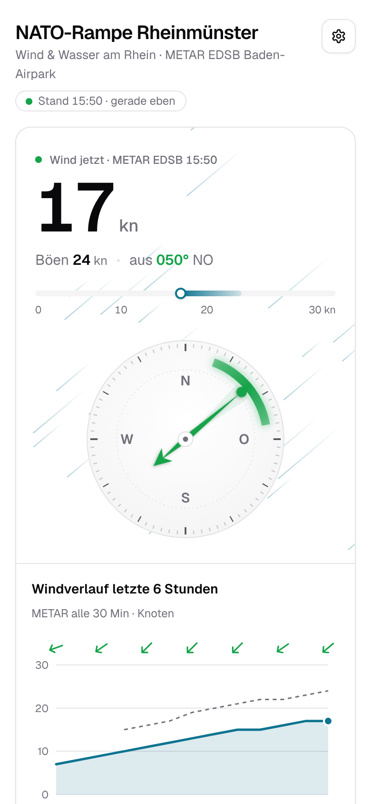
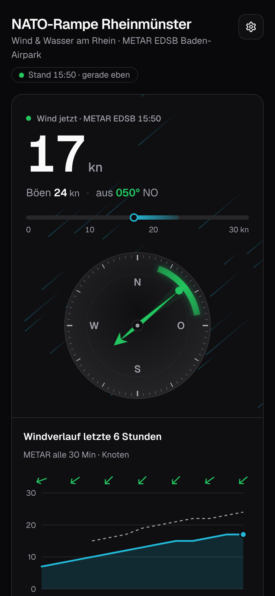
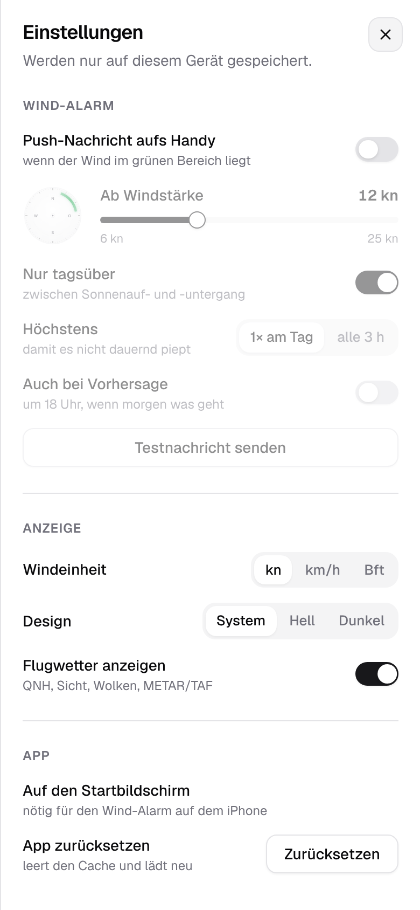
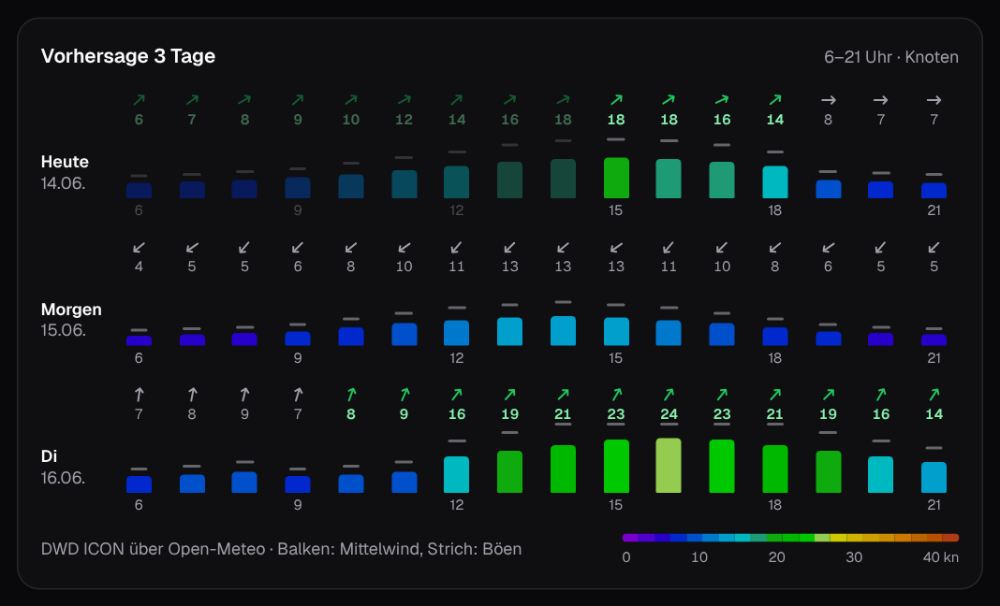

<div align="center">


<h1>Wetter NATO-Rampe Rheinmünster: Wind, Vorhersage und Rhein-Pegel</h1>

**Wind-App für Windsurfer, Wingfoiler und Parawinger an der NATO-Rampe Rheinmünster am Rhein.**<br>
Aktueller Wind vom Baden-Airpark (METAR EDSB), Vorhersage für 5 Tage, Wassertemperatur und Pegel auf einer Seite.<br>
Kostenlos, ohne Werbung, als App aufs Handy, mit Wind-Alarm per Push-Nachricht.

[](https://github.com/firsttris/Flugwetterdaten/actions/workflows/ci.yml)
[](https://github.com/firsttris/Flugwetterdaten/actions/workflows/deploy.yml)
[](https://wetter.teufel-it.de/docs/installieren.html)
[](https://wetter.teufel-it.de/docs/)
[](LICENSE)

### 👉 [wetter.teufel-it.de](https://wetter.teufel-it.de)

[Öffnen](#-öffnen-und-installieren) •
[Funktionen](#-funktionen) •
[Screenshots](#-screenshots) •
[Alternativen](#-alternativen) •
[FAQ](#-faq) •
[Dokumentation](https://wetter.teufel-it.de/docs/)


</div>

## 💡 Warum?

Wer an der Rampe aufs Wasser will, hatte bisher fünf Tabs offen: METAR vom Flughafen, Windfinder,
Pegel, Wassertemperatur, Hochwasser. Diese App zeigt das alles auf einer Seite, auf das Wesentliche
reduziert.

- **Auf einen Blick**: Windstärke, Böen und Richtung groß oben, die beste Windrichtung grün markiert.
- **Lohnt sich morgen?**: Vorhersage für 5 Tage, Stunde für Stunde, in den gewohnten Windfinder-Farben.
- **Nichts verpassen**: Der Wind-Alarm meldet sich, wenn der Wind passt.
- **Wie eine App**: aufs Handy installierbar, startet ohne Browserleiste, hell und dunkel.

Läuft auf Android, iPhone, iPad und im Browser am Rechner.

## 🚀 Öffnen und installieren

**[wetter.teufel-it.de](https://wetter.teufel-it.de)** im Browser öffnen, fertig.

Als App auf den Startbildschirm: auf Android im Chrome-Menü **App installieren**, auf dem iPhone in
Safari **Teilen → Zum Home-Bildschirm**. Mehr in der
[Installationsanleitung](https://wetter.teufel-it.de/docs/installieren.html).

## ✨ Funktionen

### 🌬️ Wind

- **Wind jetzt**: Mittelwind, Böen und Richtung aus dem METAR des Baden-Airparks (EDSB), alle 5 Minuten neu.
- **Kompass**: Nadel in Windrichtung, Nord-Ost (20–80°) grün markiert, Fächer für die Schwankung der letzten Stunde.
- **Windverlauf**: die letzten 6 Stunden mit Mittelwind, Böen und Richtung.
- **Einheiten**: Knoten, km/h oder Beaufort.

### 📅 Vorhersage

- **5 Tage, Stunde für Stunde** von 6 bis 21 Uhr, aus den DWD-Modellen ICON-D2 und ICON-EU.
- **Windfinder-Farben** für die Windstärke, Böen als Strich, Nord-Ost-Stunden grün.
- **TAF**: die offizielle Flughafen-Vorhersage, in normale Sprache übersetzt.

### 🌊 Rhein

- **Wassertemperatur** von der LUBW.
- **Pegel Iffezheim** mit Trend (steigend, fallend, stabil).
- **Strömung**, geschätzt aus dem Abfluss.
- **Hochwasserstatus** von Pegelonline.

### 🔔 Wind-Alarm

- **Push-Nachricht**, wenn der Wind aus Nord-Ost kommt und stark genug ist.
- **Einstellbar**: Mindestwind, nur tagsüber, höchstens 1× am Tag oder alle 3 Stunden.
- **Vorhersage-Alarm** am Vorabend, wenn morgen Wind angesagt ist.

### ✈️ Flugwetter

- **QNH, Sicht, Wolken, Temperatur, Taupunkt**, Sonnenauf- und -untergang, Roh-METAR.

## 📸 Screenshots

<table>
  <tr>
    <td></td>
    <td></td>
    <td></td>
  </tr>
</table>



## 🔀 Alternativen

Gemacht für genau einen Spot: alles, was man für die Rampe braucht, und nichts sonst.

| | Was es ist | Was hier anders ist |
|---|---|---|
| [Windfinder](https://www.windfinder.com/forecast/flughafen_karlsruhe_baden-baden) | Vorhersage und Messwerte weltweit | Pegel, Wassertemperatur und Wind-Alarm für die Rampe auf derselben Seite |
| [Windy](https://www.windy.com/) | Wetterkarten mit vielen Modellen | keine Karte, nur der Spot; schneller am Handy |
| [metar-taf.com](https://metar-taf.com/de/metar/EDSB) | METAR und TAF für Piloten | für Wassersportler aufbereitet, mit Verlauf und Vorhersage |
| [Pegelonline](https://www.pegelonline.wsv.de/), [HVZ](https://www.hvz.baden-wuerttemberg.de/) | amtliche Pegel | Pegel, Trend und Hochwasser neben dem Wind |

## ❓ FAQ

### Was kostet die App?
Nichts. Privates Projekt, keine Werbung, kein Tracking.

### Gibt es den Wind-Alarm auch auf dem iPhone?
Ja, ab iOS 16.4, aus der installierten App heraus. [Anleitung](https://wetter.teufel-it.de/docs/wind-alarm.html)

### Warum weicht der Wind am Spot von der App ab?
Gemessen wird am Flughafen, einige Kilometer entfernt. Mehr unter [Datenquellen](https://wetter.teufel-it.de/docs/datenquellen.html).

### Kann ich das für meinen eigenen Spot nutzen?
Ja, der Code ist MIT-lizenziert; Flughafen, Position und Windbereich sind ein paar Konstanten. [So geht's](https://wetter.teufel-it.de/docs/entwicklung.html#einen-anderen-spot-einstellen)

## 📚 Dokumentation

Die vollständige Dokumentation mit Suche: **[wetter.teufel-it.de/docs](https://wetter.teufel-it.de/docs/)**

| | |
|---|---|
| [Die App](https://wetter.teufel-it.de/docs/nutzung.html) | was jede Karte zeigt und wie man sie liest |
| [Installieren](https://wetter.teufel-it.de/docs/installieren.html) | Android, iPhone, Rechner |
| [Wind-Alarm](https://wetter.teufel-it.de/docs/wind-alarm.html) | einschalten, Regeln, Fehlersuche |
| [Datenquellen](https://wetter.teufel-it.de/docs/datenquellen.html) | woher jeder Wert kommt, was geschätzt ist |
| [Aufbau](https://wetter.teufel-it.de/docs/architektur.html) | Webseite, Cloudflare Worker, Push |
| [Betrieb](https://wetter.teufel-it.de/docs/betrieb.html) | Deployment, Secrets, Domain |
| [Entwicklung](https://wetter.teufel-it.de/docs/entwicklung.html) | lokal starten, Struktur, Checks |

## 🛠️ Entwicklung

Voraussetzung: Node.js 26.

```bash
git clone https://github.com/firsttris/Flugwetterdaten && cd Flugwetterdaten
npm install
npm run dev
```

Vite, React, TypeScript, Tailwind CSS und shadcn/ui; ein Cloudflare Worker für METAR/TAF und den
Wind-Alarm. Details: [Entwicklung](https://wetter.teufel-it.de/docs/entwicklung.html).

## 🤝 Mitmachen

Issues und Pull Requests sind willkommen. Bei einem Fehler hilft: Gerät, Browser, Uhrzeit und ein
Screenshot. Vor einem Pull Request bitte `npm run build` und `mkdocs build --strict` laufen lassen.

---

<div align="center">

⭐ Gefällt dir die App? Ein [Stern auf GitHub](https://github.com/firsttris/Flugwetterdaten) hilft anderen, sie zu finden.<br>
🐛 [Fehler melden](https://github.com/firsttris/Flugwetterdaten/issues/new) · 💡 [Idee vorschlagen](https://github.com/firsttris/Flugwetterdaten/issues/new)

<sub>Lizenz: <a href="LICENSE">MIT</a> · © Tristan Teufel und Mitwirkende<br>
Alle Daten dienen nur der Orientierung und ersetzen keine offizielle Flugwetterberatung oder Gefahrenprüfung.<br>
Keine Verbindung zum Flughafen Karlsruhe/Baden-Baden, zu Windfinder, zum DWD, zur WSV oder zur LUBW.</sub>

</div>
