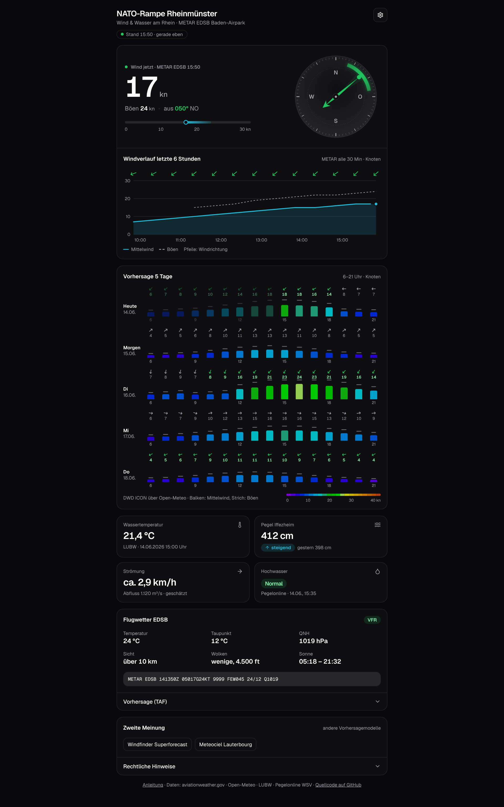

# Wetter NATO-Rampe Rheinmünster

**Wind, Vorhersage und Rhein-Pegel an der NATO-Rampe Rheinmünster, mit Wind-Alarm aufs Handy.**

Die App zeigt auf einer Seite, ob sich der Weg an den Rhein lohnt: den aktuellen Wind vom
Baden-Airpark, die Vorhersage für fünf Tage, Wassertemperatur, Pegel und Strömung. Auf Wunsch meldet
sie sich von selbst, wenn der Wind passt.

**Zur App: [wetter.teufel-it.de](https://wetter.teufel-it.de)**

## Was steht wo?

| Seite | Inhalt |
|---|---|
| [Die App](nutzung.md) | Was die einzelnen Karten zeigen und wie man sie liest |
| [Auf dem Handy installieren](installieren.md) | Die App auf den Startbildschirm holen, auf Android, iPhone und am Rechner |
| [Wind-Alarm](wind-alarm.md) | Push-Nachricht bei passendem Wind: einschalten, einstellen, testen |
| [Datenquellen und Berechnungen](datenquellen.md) | Woher jeder Wert kommt, wie oft er sich ändert und was geschätzt ist |
| [Häufige Fragen](faq.md) | Kurze Antworten auf das, was oft gefragt wird |
| [Aufbau](architektur.md) | Webseite, Cloudflare Worker und wie die Teile zusammenspielen |
| [Betrieb und Deployment](betrieb.md) | Veröffentlichen, Secrets, Domain, Screenshots |
| [Entwicklung](entwicklung.md) | Lokal starten, Projektstruktur, Checks |

!!! warning "Keine Gewähr"
    Alle Daten dienen nur der Orientierung und ersetzen keine offizielle Flugwetterberatung oder
    Gefahrenprüfung. Nutzung auf eigene Gefahr.
