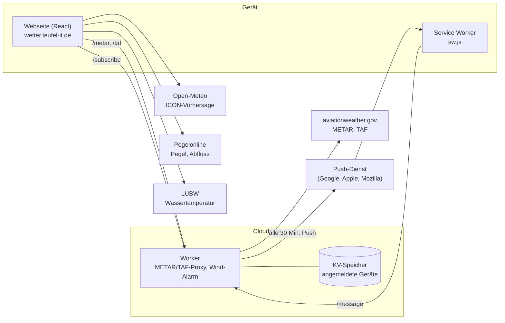

# Aufbau

Die App besteht aus zwei Teilen: einer statischen Webseite auf GitHub Pages und einem kleinen
Cloudflare Worker. Eine Datenbank oder einen eigenen Server gibt es nicht.

## Webseite

| Bereich | Umsetzung |
|---|---|
| Technik | Vite, React 19, TypeScript, Tailwind CSS 4, Komponenten im Stil von shadcn/ui auf Radix |
| Daten | direkt aus dem Browser von Open-Meteo, Pegelonline und LUBW (die erlauben das per CORS); METAR und TAF über den Worker, weil aviationweather.gov keinen Abruf aus dem Browser erlaubt |
| Aktualisierung | `usePolling` lädt jede Quelle in ihrem Takt neu und beim Zurückkehren in die App |
| Einstellungen | im `localStorage` unter `rm-settings` |
| Zeiten | immer deutsche Ortszeit (`Europe/Berlin`), unabhängig von der Zeitzone des Geräts |
| Schrift | Geist, mit der App ausgeliefert (kein Google Fonts) |

Wichtige Dateien:

| Datei | Inhalt |
|---|---|
| `src/lib/config.ts` | Worker-Adresse, Position, grüner Bereich, Ladetakt |
| `src/lib/api.ts` | Abruf und Umrechnung aller Quellen |
| `src/lib/units.ts` | Einheiten, Himmelsrichtungen, Windfinder-Farben, Zeitformat |
| `src/lib/push.ts` | Service Worker, Push-Anmeldung, Zurücksetzen |
| `src/components/` | die Karten: `wind-now`, `compass`, `wind-streaks`, `forecast`, `river-stats`, `flight-weather`, `settings-sheet` |
| `public/sw.js` | Service Worker: kein Offline-Cache, nur Push |

## Cloudflare Worker

`worker/src/index.ts`, Endpunkte:

| Methode und Pfad | Zweck |
|---|---|
| `GET /metar?hours=6` | METAR EDSB der letzten Stunden, 60 s im Cloudflare-Cache |
| `GET /taf` | TAF EDSB, 10 min im Cache |
| `GET /config` | öffentlicher VAPID-Schlüssel für die Push-Anmeldung |
| `POST /subscribe` | Gerät anmelden oder Einstellungen ändern |
| `POST /unsubscribe` | Gerät abmelden |
| `GET /message?endpoint=…` | Text der letzten Nachricht für dieses Gerät |

Dazu ein **Cron alle 30 Minuten** (`runAlarm`), der den METAR und um 18 Uhr die Vorhersage prüft,
siehe [Wind-Alarm](wind-alarm.md#wie-die-prüfung-abläuft).

### Push ohne Inhalt

Der Worker schickt leere Pushes, nur mit VAPID-Anmeldung (RFC 8292). Der Service Worker auf dem
Gerät holt den Text danach über `/message` ab und zeigt ihn an. So braucht der Worker keine
Verschlüsselung des Inhalts (RFC 8291) und keine zusätzliche Bibliothek; die Signatur entsteht mit
WebCrypto (`worker/src/push.ts`).

### Speicher

Jedes Gerät liegt im KV-Namespace `SUBSCRIPTIONS` unter `sub:<SHA-256 der Push-Adresse>` mit:
Push-Adresse, Einstellungen (Mindestwind, tagsüber, Häufigkeit, Vorhersage-Alarm, Einheit), Zeitpunkt
der letzten Nachricht und dem letzten Nachrichtentext. Meldet der Push-Dienst `404` oder `410`, wird
der Eintrag gelöscht.
