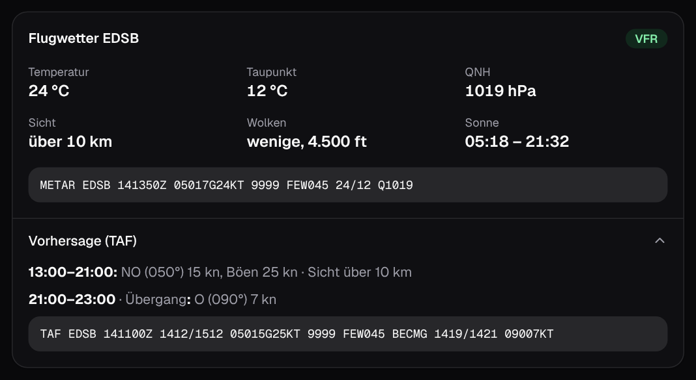

# Die App

Die Seite ist von oben nach unten nach Wichtigkeit sortiert: zuerst der Wind, dann die Vorhersage,
dann der Rhein, zuletzt das Flugwetter. Alle Werte laden sich alle paar Minuten von selbst neu und
sofort, wenn du die App wieder öffnest.

## Kopfzeile

Neben dem Titel steht, wann der letzte METAR gemessen wurde, zum Beispiel **Stand 15:50 · vor 8 Min**.
Ist die Messung älter als 90 Minuten, steht dort **Veraltet** und der Punkt wird grau. Rechts oben
öffnet das Zahnrad die [Einstellungen](#einstellungen).

## Wind jetzt

Die große Zahl ist der **Mittelwind** aus dem letzten METAR des Baden-Airparks (EDSB). Darunter
stehen die **Böen** und die **Richtung**, aus der der Wind kommt, in Grad und als Himmelsrichtung.

- **Balken**: zeigt die Spanne vom Mittelwind (Kreis) bis zu den Böen (Ende des Verlaufs) auf einer
  Skala bis 30 kn. Je länger der Verlauf, desto böiger.
- **Kompass**: Die Nadel zeigt, **wohin** der Wind weht; der Kreis am anderen Ende markiert, woher er
  kommt. Der **grüne Bereich** (20–80°, Nord-Ost) ist die Lieblingsrichtung am Spot. Liegt der Wind
  darin, werden Nadel und Gradzahl grün.
- **Fächer**: der blasse Keil um die Nadel zeigt, wie stark die Richtung in der letzten Stunde
  geschwankt hat.
- **VRB** statt Nadel: der Wind kommt aus wechselnden Richtungen oder es ist windstill.
- **Windlinien** im Hintergrund ziehen in Windrichtung, schneller bei mehr Wind.

## Windverlauf letzte 6 Stunden

Mittelwind als Fläche, Böen gestrichelt, darüber kleine Pfeile für die Richtung. Grüne Pfeile
bedeuten Nord-Ost. So sieht man, ob der Wind gerade zunimmt, nachlässt oder dreht.

## Vorhersage 3 Tage

Eine Zeile pro Tag, eine Spalte pro Stunde von 6 bis 21 Uhr:

- **Pfeil** oben: Windrichtung, grün bei Nord-Ost.
- **Zahl**: Mittelwind, fett und grün bei Nord-Ost.
- **Balken**: Mittelwind, eingefärbt nach der Windfinder-Skala (lila wenig Wind, grün um 20 kn,
  gelb und orange darüber). Die Legende steht unter der Vorhersage.
- **Strich** über dem Balken: Böen.

Vergangene Stunden des heutigen Tages sind blasser. Die Werte kommen aus dem Wettermodell ICON des
Deutschen Wetterdienstes, siehe [Datenquellen](datenquellen.md#vorhersage).

## Rhein

| Kachel | Bedeutung |
|---|---|
| **Wassertemperatur** | letzte Messung der LUBW mit Uhrzeit |
| **Pegel Iffezheim** | aktueller Wasserstand; „steigend“ oder „fallend“, wenn er sich seit gestern um mehr als 2 cm geändert hat |
| **Strömung** | grob geschätzte Oberflächenströmung aus dem Abfluss, deshalb „ca.“ ([wie gerechnet](datenquellen.md#strömung)) |
| **Hochwasser** | Normal, Niedrigwasser oder Hochwasser laut Pegelonline |

## Flugwetter EDSB

Temperatur, Taupunkt, Luftdruck (QNH), Sicht, Wolken, Sonnenauf- und -untergang, die
Flugwetterkategorie (VFR, MVFR, IFR) und der METAR im Original. Unter **Vorhersage (TAF)** steht die
offizielle Flughafen-Vorhersage für die nächsten 24 bis 30 Stunden, in normaler Sprache und darunter
im Original. Die Karte lässt sich in den Einstellungen ausblenden.

## Zweite Meinung

Links zu Windfinder Superforecast und Meteociel. Das sind andere Vorhersagemodelle, gut zum
Vergleichen, wenn man unsicher ist.

## Einstellungen

Alle Einstellungen bleiben nur auf diesem Gerät gespeichert.

| Einstellung | Wirkung |
|---|---|
| **Wind-Alarm** | Push-Nachricht bei passendem Wind, siehe [Wind-Alarm](wind-alarm.md) |
| **Windeinheit** | Knoten, km/h oder Beaufort, für alle Anzeigen |
| **Design** | System, Hell oder Dunkel |
| **Flugwetter anzeigen** | blendet die Karte Flugwetter ein oder aus |
| **Auf den Startbildschirm** | installiert die App, wenn der Browser das anbietet ([Anleitung](installieren.md)) |
| **App zurücksetzen** | leert den Cache und lädt die Seite neu, hilft, wenn etwas hängt |

!!! tip "Bewegung reduzieren"
    Ist auf dem Gerät „Bewegung reduzieren“ eingeschaltet, zeigt die App alles ohne Animationen.
